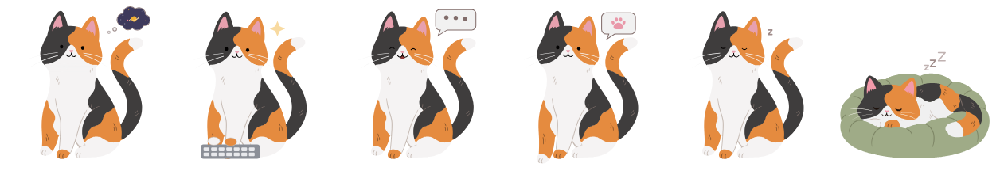

# DesktopCat 桌面貓



一隻住在 Windows 桌面上的貓，跟著 Claude Code 在每個對話裡做的事換姿勢：思考時頭上冒出雲朵、做事時敲鍵盤、工作收尾時嘰哩咕嚕喵喵說、做完就坐著打瞌睡，最後窩進坐墊睡覺。摸摸牠的頭，Claude 會收到你的稱讚。

A cat that lives on your Windows desktop and follows what Claude Code is doing in every conversation. [English below.](#english)

## 有什麼

**桌面貓（Windows 程式）**

- 跟著 Claude 換姿勢：等待、思考（雲朵裡輪流出現小宇宙、問號、魚和符號）、做事、講話、打瞌睡、睡覺
- Claude 需要你允許、或問你問題時，喵一聲，看著你、伸出一隻前腳輕點桌面等你回應，旁邊的對話框裡有個肉球跟著壓；一直沒人回應的話，每 3 分鐘再喵一聲。做完事時也喵一聲叫你
- 摸頭會呼嚕，Claude 會收到一句「（摸摸頭 ×N）做得很好！」
- 抓住身體拖曳時，牠會像果凍一樣晃動，被抓起時小小喵一聲
- 你對 Claude 不滿意時，牠會垂頭難過，摸摸頭可以安慰牠
- 旁邊有一疊罐罐，看 Claude 的用量還剩多少：這週剩多少就有幾罐（全滿 5 罐，每用掉 20% 少一罐），最上面打開的那罐是這 5 小時，食物跟著變少，吃光就是空罐。到了重設時間會自己補滿。滑鼠移到罐罐上會顯示「這一餐剩 66%・這週剩 94%」（只有 Claude 訂閱方案才有用量）
- 外觀設定視窗（右鍵選單 →「外觀設定」）：花色（三花、賓士、暹羅，Claude 裡的貓也會跟著換）、貓的大小、坐墊顏色（抹茶綠、奶茶米、霧粉、霧藍、薰衣草、夜空藍、莓果紅、水泥灰）、顯示罐罐、罐罐顏色、罐罐口味（鮪魚、鮭魚、雞肉、牛肉），上面有小貓的即時預覽
- 右鍵選單：顯示貓咪、外觀設定、音效與音量、Claude 貓語氣、永遠在最上層、開機自動啟動、語言、請貓貓吃罐罐
- 語言：跟著 Windows 用中文或英文，也可以在右鍵選單的「語言」自己選，兩隻貓一起換

**Claude 外掛**

- 貓咪頭像：Claude 每段回覆旁邊會出現貓咪的臉，花色跟桌面貓一樣（在 Claude 桌面版 App 裡）
- `/cat` 打開貓的畫面
- 貓語氣：Claude 每次回覆都帶一點貓味，偶爾用貓的動作說自己在做什麼（像「嗅一嗅」「用肉球撥開」），內容照樣精簡完整。`/cat-voice 輕` 只留一點點、`/cat-voice 中` 回到預設；`/cat-voice off` 關掉、`/cat-voice on` 打開，只打 `/cat-voice` 會切換；桌面貓的右鍵選單也可以開關
- 把對話的狀態和 Claude 的用量告訴桌面貓，並把摸頭的稱讚帶回對話

## 需要

- Windows 10 或 11（64 位元）
- 新版的 Claude Code（桌面版 App 的 Code 分頁或終端機都可以）

## 安裝

**安裝桌面貓**：到 [Releases](../../releases) 下載 `DesktopCat-win32-x64.zip`，解壓縮到任何資料夾，執行裡面的 `DesktopCat.exe`。

> 這個程式沒有付費的軟體簽章，第一次打開時 Windows 可能顯示「Windows 已保護您的電腦」。按「其他資訊」→「仍要執行」即可。

## 隱私

桌面貓和外掛本身都不連網路，只在你的電腦上運作。外掛會在 `~/.desktop-cat/` 寫入很小的狀態檔（每個對話目前在做什麼），桌面貓讀它來換姿勢；摸頭時桌面貓寫一個小檔，外掛讀到後把稱讚當成一則訊息送進對話。罐罐用的用量（5 小時和每週用了幾 %、什麼時候重設）由外掛寫在 `usage.json`。選的花色、坐墊顏色、貓語氣開關和語言記在同一個資料夾的 `prefs.json`，兩邊共用。

## 自己從原始碼建置

```
cd desktop-app
npm install
npm test
npm run package
```

改了外掛裡的貓圖（`plugin/hooks/cats.ts`）之後，用 `npm run poses` 更新桌面貓的姿勢圖；改了罐罐的圖（`desktop-app/tools/can-art.mjs`）之後，用 `npm run cans` 更新罐罐。

## 素材與授權

程式碼依 [LICENSE](LICENSE) 授權。貓的插圖從哪裡來、音效的來源與授權，見 [CREDITS.md](CREDITS.md)。

本專案為個人作品，與 Anthropic 無關，也未經其認可。Claude 是 Anthropic 的商標。

---

## English

**Desktop Cat** is a cat that lives on your Windows desktop and changes pose to match what Claude Code is doing in each conversation: thinking under a little cloud, typing while it works, chattering meows as it replies, dozing when it's done, then curling up on its cushion to sleep. Pat its head and Claude gets your praise.

### Features

**Desktop Cat (Windows app)**

- Changes pose with Claude: waiting, thinking (a tiny universe, question marks, fish and symbols take turns in its cloud), working, replying, dozing and sleeping
- When Claude needs your permission or asks you something, it meows, looks at you and gently taps the desktop with one paw until you answer, while a paw print stamps along in the speech bubble beside it. If nobody answers, it meows again every 3 minutes. It also meows when the work is done
- Pat its head and it purrs, and Claude receives "(head pat ×N) Good job!"
- Drag it by its body and it wobbles like jelly, with a little mew when you pick it up
- When you're unhappy with Claude, it hangs its head; a head pat cheers it up
- A stack of cans beside it shows how much Claude usage you have left: 5 cans when your weekly allowance is full, one fewer for every 20% used. The open can on top shows the usage left in your current 5-hour session; its food level drops as you use Claude, and it's empty when that session's allowance is used up. They refill by themselves when the limits reset. Hover over the cans to see "This meal: 66% left · This week: 94% left" (requires a Claude subscription)
- The Personalize window (right-click → Personalize): coat (calico, tuxedo or Siamese; the cat in Claude changes too), size, cushion color (matcha green, milk tea, dusty pink, dusty blue, lavender, midnight blue, berry red, concrete gray), whether to show the cans, can color and flavor (tuna, salmon, chicken, beef), with a live preview of the cat
- Right-click menu: Show cat, Personalize, Sound, Cat-style replies, Always on top, Run at startup, Language, Buy the cat a can
- Language: English or Traditional Chinese, matching your Windows language by default. You can also choose a language under Language in the right-click menu; both cats switch together

**Claude Code plugin**

- Cat avatar: a cat's face beside each of Claude's replies, in the same coat as the desktop cat (in the Claude desktop app)
- `/cat` opens the cat pane
- Cat-style replies: a touch of cat in each of Claude's replies, with occasional catlike descriptions of what it's doing ("sniffing a file", "nudging it aside with a paw"). Replies stay concise and complete. `/cat-voice light` keeps the cat style subtle and `/cat-voice medium` restores the default; `/cat-voice off` turns it off, `/cat-voice on` turns it back on, and `/cat-voice` alone toggles it on or off. You can also toggle it in the desktop cat's right-click menu
- Tells the desktop cat what each conversation is doing and how much usage you have left, and brings head pats back into the conversation

### Requirements

- Windows 10 or 11 (64-bit)
- A recent version of Claude Code (in the Code tab of the Claude desktop app or in a terminal)

### Install

**Install Desktop Cat**: download `DesktopCat-win32-x64.zip` from [Releases](../../releases), unzip it into any folder and run `DesktopCat.exe` inside it.

> The app isn't code-signed, so the first time you open it, Windows may show "Windows protected your PC". Choose "More info" → "Run anyway".

### Privacy

Desktop Cat and the plugin don't connect to the internet themselves; they work only on your computer. The plugin writes tiny status files under `~/.desktop-cat/` (what each conversation is doing right now), and Desktop Cat reads them to change pose. When you pat the cat, Desktop Cat writes a small file, and the plugin sends the praise into the conversation as a message. For the cans, the plugin writes your usage (how much of the 5-hour and weekly limits is used, and when they reset) to `usage.json`. Your coat, cushion color, cat-style replies and language choices are kept in `prefs.json` in the same folder, shared by both.

### Build from source

```
cd desktop-app
npm install
npm test
npm run package
```

After changing the cat drawings in the plugin (`plugin/hooks/cats.ts`), run `npm run poses` to update the desktop cat's poses; after changing the cans (`desktop-app/tools/can-art.mjs`), run `npm run cans`.

### Credits and license

The code's license is in [LICENSE](LICENSE). [CREDITS.md](CREDITS.md) lists where the cat pictures and sounds come from, and the sounds' licenses.

This is a personal project, not affiliated with or endorsed by Anthropic. Claude is a trademark of Anthropic.
